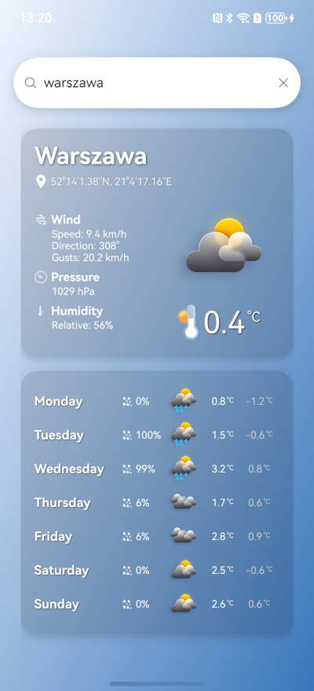

# MyMeteo

A weather application for OpenHarmony with a mobile UI and a wearable proof of concept.
Both products share the same data and utility modules.



## Products

| Product | Entry module | Devices | Scope |
| --- | --- | --- | --- |
| `default` | `entry` | Mobile (`default`) | City search, current weather, daily forecast and saved cities |
| `watch` | `watch` | Wearable | Current weather for the device location |

Both products compile against **OpenHarmony SDK API 23** and require **API 20 or later**.
The module target is `default` for each product; select the product to choose the UI.

The mobile UI draws its background behind translucent system-bar panels. The status
bar and search panel share the same darker glass color. City lists and
weather panels scroll underneath them; the glass search panel collapses when scrolling
up and returns when scrolling down. Pull down at the top of a weather page to fetch
current weather and forecast again, bypassing the 15-minute cache. A failed refresh
keeps the displayed data and its original update time. The retrieval time appears
below the forecast, in a smaller font. The refresh spinner is white and the search
field uses regular 15vp white text with a subtle shadow on darker glass. Its panel
is 64vp tall. Search results and saved cities share the weather cards' translucent
blue background, rounded corners, white text and soft shadow.

Mobile startup requests foreground location permission and opens current weather
and the forecast for the device location. Denied permission, unavailable GPS or
network failure falls back to the most recently retrieved complete weather in the
database. Without usable saved weather, startup opens an empty search screen.
Manual search takes precedence over a late location response.

Both products share four subtle pastel blue backgrounds representing clear, cloudy,
rainy and snowy weather. The wearable crops the sky to its round viewport and uses
a subtle blue overlay for small white labels. A decoded image fades in over 2.4 seconds above the gradient or previous
weather background. Refreshing the same weather family does not restart the fade.
The [GPT Image prompts and asset paths](images/weather-backgrounds/PROMPTS.md)
record the generated originals.

The wearable PoC obtains location after the permission prompt, reverse-geocodes it with
Nominatim, then displays current weather. Loading and failure states remain visible;
permission denial never closes the app. Retry repeats the same existing weather flow.
The scope excludes background updates, phone/watch synchronization, new forecast views,
and additional settings. A wearable cold start needs location and network access for
reverse geocoding.

## Build and run

Install DevEco Studio and OpenHarmony SDK API 23. Configure development signing in
`build-profile.json5`; signing files live in the ignored `signatures/` directory.
Generated signing materials and local SDK paths must stay local.

```powershell
devecocli build --product default --modules entry
devecocli build --product watch --modules watch

devecocli run --product default --module entry --device "Pura 80 Pro"
devecocli run --product watch --module watch --device Huawei_Wearable
```

Select the equivalent `default` or `watch` product in DevEco Studio.
Signed packages are produced at:

- `entry/build/default/outputs/default/entry-default-signed.hap`
- `watch/build/watch/outputs/default/watch-default-signed.hap`

CI uses the [Oniro App Builder](https://github.com/eclipse-oniro4openharmony/oniro-app-builder)
with SDK 6.1 (API 23), generates development signing materials and builds both products.
Artifacts are named `MyMeteo-default` and `MyMeteo-watch`.

## Architecture

- `entry`: mobile ArkUI views and ViewModel.
- `watch`: wearable ArkUI view and ViewModel.
- `data`: repository, local RDB/DAO/mapper layer, HTTP APIs and location provider.
- `common`: shared utility functions, weather backgrounds, resources and permission handling.

Abilities initialize the database and inject the repository into their ViewModel before
loading the main page. Both pages request GPS after permission handling.
The shared repository returns cached weather younger than 15 minutes. Older complete
weather is used when refreshing fails; without cached data, the failure is reported.
Weather and forecast requests run in parallel. HTTP requests have bounded timeouts and
always release their resources. Database queries always close their result sets.

Data providers:

- [Open-Meteo](https://open-meteo.com/en/docs): current weather and daily forecasts.
- [Nominatim](https://nominatim.org/release-docs/develop/api/Overview/): city search and
  reverse geocoding. Its string coordinates are normalized to numeric application DTOs.

## Core regression tests

The host tests run the production data layer with substituted platform APIs. They cover
cache freshness, forced refresh and offline fallback, input validation, weather mapping, HTTP cleanup,
database cleanup, permission denial and ViewModel initialization.

```powershell
npm install --no-save --package-lock=false typescript@4.9.5
node --test tests/core.test.cjs
```

Alternatively, point `CORE_TYPESCRIPT_PATH` at DevEco's installed TypeScript module.
Host tests complement the ArkTS builds and emulator checks; they do not replace them.

See [VALIDATION.md](VALIDATION.md) for the PoC review and verification record.

## License

See [LICENSE.txt](LICENSE.txt).
